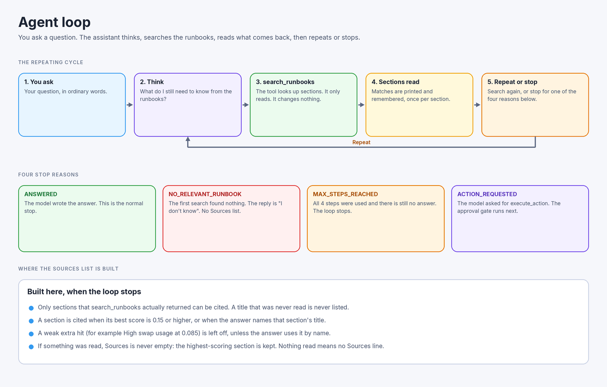
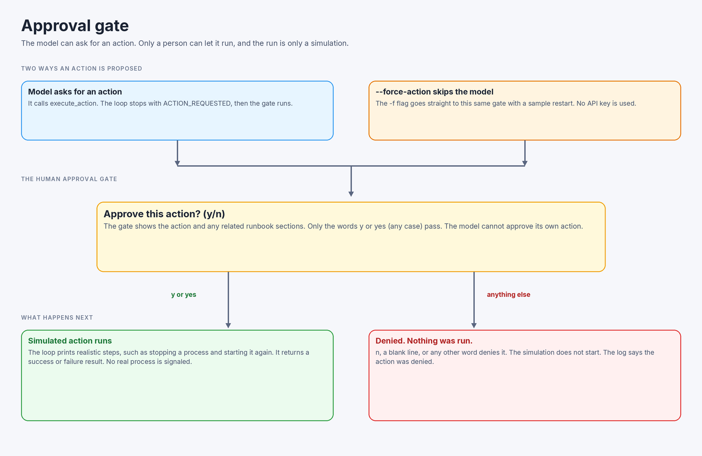
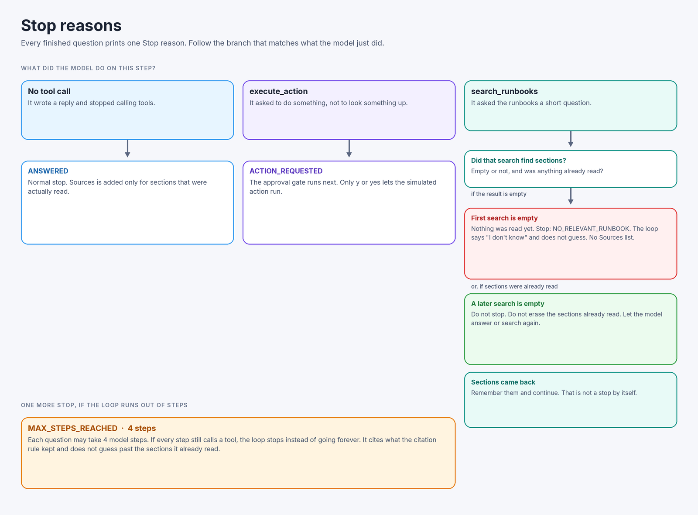
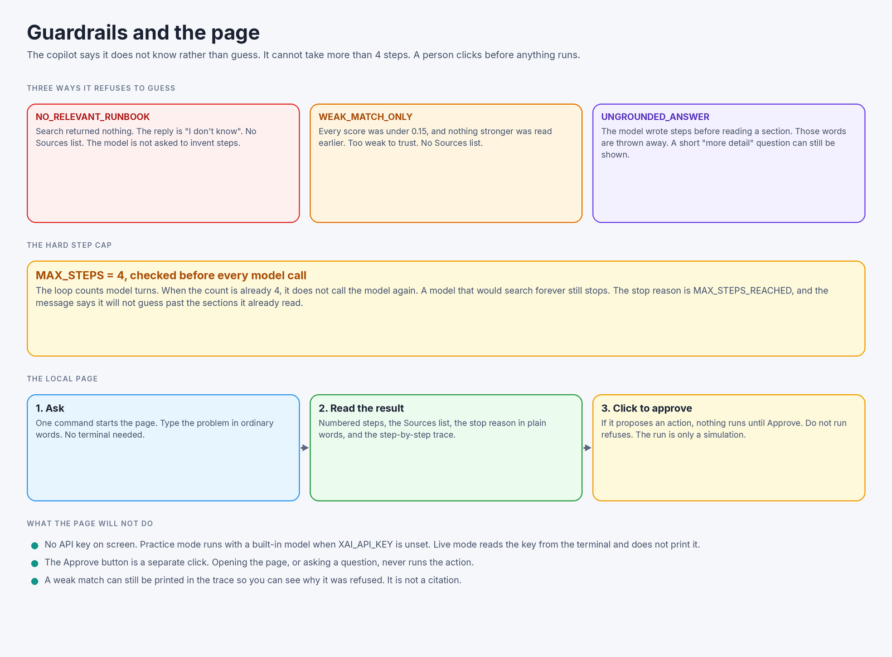
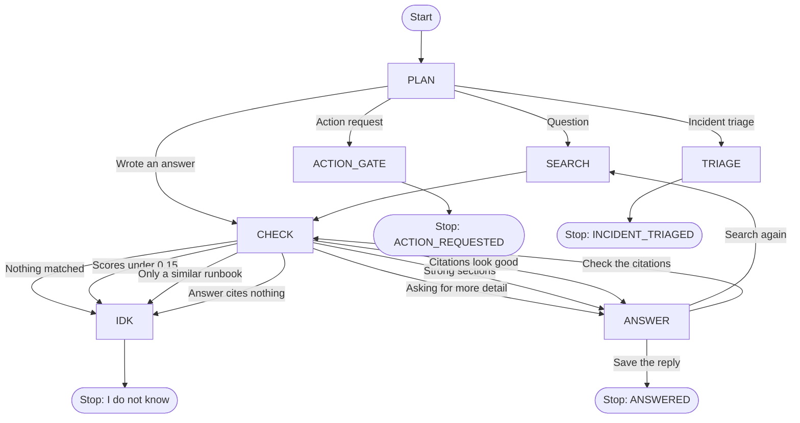

# runbook-copilot

**Goal:** an agent that searches a runbook knowledge base (RAG) and takes actions via tool calls, with a human approval step before anything runs.

## Status

Working end to end, with a stub for the action itself. `execute_action` only prints what it would do and never changes a real system.

- Search: the `search_runbooks` tool uses `retrieve.py`, which splits each runbook at its `# ` headers first, then cuts each section into chunks (about 400 characters, 80 overlap) so a chunk never mixes sections. It ranks chunks with TF-IDF and returns the top 3 with scores.
- Agent loop: `agent.py` asks the model (Grok, model `grok-build-0.1`, through the xAI API) one step at a time. The model thinks, calls `search_runbooks`, reads the sections, and can search again. It then writes a short plain-language answer and cites the sections that answer relies on, or stops for a named reason. See "The agent loop" below.
- Graph: `graph_agent.py` is the same loop drawn as boxes and arrows. `agent.py` is unchanged. The page still uses the loop. See "The same loop, drawn as boxes" below.
- Approval gate: the agent shows the proposed action and related runbook sections, then asks `Approve this action? (y/n)`. Only `y` or `yes` lets it through. The model cannot approve its own action. The local page uses the same rule: nothing runs until you click Approve, and that click only simulates the action.
- Page: `app.py` is a small local web page so you can ask a question without the terminal. It shows the numbered steps, the Sources, the stop reason in plain words, and the step-by-step trace. The same page has an incident triage form. See "The page" and "Incident triage" below.

## How it works

1. Loop: think, search the runbooks, read the sections, and repeat until a stop reason. Details are in "The agent loop" below.
2. Propose: the model may ask for `execute_action`.
3. Approve: a human types y or n.
4. Execute: only approved actions run (stub for now).

## The agent loop

Asking a question runs a short loop. `run_agent` in `agent.py` repeats a few steps, then stops for a reason you can read.



1. **Think.** The model writes what it still needs. If it stays quiet, the loop says which search it is about to run, so this step is never invisible.
2. **Search.** It calls the `search_runbooks` tool. That tool is `retrieve.search`, the same search the rest of the project uses.
3. **Read.** The sections that come back are printed and handed to the model. Each section is remembered once, even if two chunks share a title. A weak hit is still shown here. It is not a citation yet.
4. **Repeat or stop.** The model may search one more time when the sections are on the right topic but miss a detail. It should not keep changing the words after a search that found nothing, or only weak matches. When it can answer, it stops calling tools and writes a short reply in plain language: a few numbered steps, in its own words, using only the sections it read. It should not paste the runbook text back under a bold title. The prompt still says do not invent sections, and say "I don't know" when nothing relevant was found. Before that reply is kept, the loop checks that the runbook is really about the same problem. See "Check the runbook really matches" below. If the person asks to restart, delete, or roll back something, the model should call `execute_action` right away, unless it cannot tell what to act on. That still stops at the approval question (`y` or `yes` only). `--force-action` still skips the model and goes straight to that question.



The printed answer ends with a `Sources:` list. That list is built when the loop stops, from sections `search_runbooks` actually returned on this run. The same list is on `agent.last_trace.sources`.

**Citation rule.** A section is cited when its best score is at least `CITE_MIN_SCORE` in `agent.py` (0.15), or when the answer text names that section's title. A weaker neighbor (for example "High swap usage" at 0.085 beside a CPU section at 0.49) is left off, unless the answer names it. If every read section is under 0.15, the loop does not answer at all: that stop is `WEAK_MATCH_ONLY`, and Sources stays empty. A title search did not return is never listed. A Sources block written by the model is removed and replaced by this rule. Search can still print a weak hit; Sources is the shorter list.



Every `run_agent` call that finishes normally prints one line, `Stop reason: NAME`. That name is how you tell why it stopped. It is also stored on `agent.last_trace.stop_reason`.

- `ANSWERED` — the model had enough information and wrote an answer. This is the normal stop.
- `NO_RELEVANT_RUNBOOK` — the first search found nothing useful, and nothing had been read on an earlier step. The answer says "I don't know" and there is no Sources list. The loop writes that itself and stops. An empty search on a later step does not do this: sections already read stay, and the loop keeps going.
- `WEAK_MATCH_ONLY` — search returned sections, but every score was under `CITE_MIN_SCORE` (0.15) and nothing stronger was read earlier. That is not enough to answer from. The loop says "I don't know", cites nothing, and does not ask the model to invent steps. The weak hits are still printed so you can see why. A later weak search does not erase a strong section that was already read.
- `UNGROUNDED_ANSWER` — the model wrote an answer before reading any section (numbered steps, or anything that is not a short request for more detail). Those words are dropped. The loop says "I don't know" and cites nothing. A short "Please give me more detail." is still shown, because that is a question, not a guess.
- `MAX_STEPS_REACHED` — the loop used every step allowed by `MAX_STEPS` in `agent.py` (4) and still had no answer. It cites the sections the citation rule kept and stops. See "The step cap" below.
- `ACTION_REQUESTED` — the model asked for `execute_action`. The approval gate runs next, the same way as before. On the page, the action waits for a button instead.
- `INCIDENT_TRIAGED` — `triage_incident` ranked hypotheses from the evidence in that call. The answer says the root cause is not confirmed. No check and no restart runs. This stop does not cite a runbook section. The evidence ids are listed on the hypotheses they matched.

`WEAK_MATCH_ONLY` and `UNGROUNDED_ANSWER` are the same idea as `NO_RELEVANT_RUNBOOK`: do not guess. They have their own names so a log shows which guardrail fired.



A run looks roughly like this:

```
Step 1 of 4
Thinking: I should search the runbooks for 'high cpu'.
Model chose: search_runbooks({'query': 'high cpu'})
Reading 1 result(s) from the runbooks.
1. [0.420] High CPU on web servers (sample_runbook.txt)
   ...
Step 2 of 4
Stop reason: ANSWERED
The copilot answered from the runbook sections it read.
Answer: 1. Find the worker that is using the CPU.
2. Restart that worker.

Sources:
- High CPU on web servers (sample_runbook.txt)
```

The pictures above are drawn by `make_diagrams.py` (Pillow). Run `python make_diagrams.py` to regenerate the PNGs in `images/`. No secrets are drawn into them.

## The step cap

`MAX_STEPS` in `agent.py` is 4. That is the only limit, and the loop reads it at the start of each question.

Before every model call the loop asks a small counter, `ModelCallBudget`, whether another call is still allowed. When the count is already 4, the loop does not call the model. It stops with `MAX_STEPS_REACHED`. If it already read a strong section, the message says it will not guess past those sections. If it read nothing strong, the message says "I could not find this in the runbooks." The stop reason name is still `MAX_STEPS_REACHED`. A model that would search forever still stops at step 4. Tests cover that with a fake model that never stops asking for `search_runbooks`.

An answer on the last allowed step is still `ANSWERED`. The cap stops extra calls. It does not throw away a real answer.

## When search keeps changing the words

On a real-model pass, 4 of 30 questions used every step and never gave an answer. The model kept searching with new words. One question was "How do I tune Postgres vacuum for a large table", which the runbooks do not cover. It searched, got a weak hit, searched again, got nothing, and then hit the step limit. "Restart the stuck web worker" is a request to do something. The model searched four times instead of proposing the action so a person can approve it. The same thing happened for "A container keeps restarting but there is no memory error in the logs" and "Delete old logs to free disk space".

The instructions now say two short rules. After one search that returns nothing, or only weak matches, do not search again with different words. Say the runbooks do not cover this. If the person asks to restart, delete, or roll back something, call `execute_action` right away so a human can approve it. Do not search first unless the target is unclear.

The code also stops on its own, so this does not depend on the model obeying the instructions. If a search returns nothing, or only weak matches, and the next search is the same kind of miss, the loop stops. The answer is the same "I don't know" idea as an empty search, and it says it could not find this in the runbooks. A single weak search still stops the way it did before, so the practice model is unchanged. If the loop would hit the step limit with no answer and no strong section, it says "I could not find this in the runbooks." The stop reason name stays `MAX_STEPS_REACHED`, so a count of that name still works. A person still has to approve any action. Nothing runs without that click.

The practice model does the same thing as before. The new tests use fake models. They do not call a real model, and they do not use an API key. Whether the real model stops sooner has not been measured yet. That needs a real run.

## Check the runbook really matches

Search can hand back a runbook that shares a few words with the question but is about a different problem. A server disk runbook is not the answer for a full phone. A runbook about a server you cannot reach is not the answer for a laptop waiting on a password.

The instructions tell the model to check, before it answers, that the runbook is about the same problem and the same kind of system. A server is not a laptop, a phone, or a browser. The tool named in the question has to be the tool in the runbook. The symptom has to be the same one. If the runbook is only similar, the model should say the runbooks do not cover it, say in one short sentence what the closest runbook covers, and not give that runbook's steps as the answer.

The code checks this too, so it does not depend on the model obeying. Before the answer is kept, a section has to score at least `MATCH_MIN_SCORE` in `agent.py` (the same 0.15 line as a citation). At least one distinctive word from the question has to appear in that section. Everyday words such as "the" or "user" do not count. If the question says laptop, iphone, phone, browser, home, or wi-fi, that word has to be in the runbook text as well. If the check fails, the copilot says it does not know, the same way it does for `NO_RELEVANT_RUNBOOK` or `WEAK_MATCH_ONLY`. It does not list that runbook as a source.

This is a simple word check. It looks for the same whole word, so "server" and "servers" count as different words. It can be wrong: it can refuse a real match, or accept a wrong runbook when one real word happens to appear. It is not yet proven on the real model. The tests use fakes and the practice model. They do not call a real model, and they do not use an API key.

## The same loop, drawn as boxes

`agent.py` walks in a circle: think, search, read, then do that again or stop. `graph_agent.py` is the same work drawn as boxes and arrows. You stand in one box. The box tells you the next box. That kind of picture is called a state machine.

The page still uses `agent.py`. The graph is a second copy of the same rules, so you can compare the two. It adds no packages. LangGraph is not used yet.



- **PLAN** decides. A question goes to SEARCH. An action request goes to ACTION_GATE. A written answer goes to CHECK.
- **SEARCH** calls the same `search_runbooks` tool as the loop.
- **CHECK** applies the same guardrails. Nothing matched, every score under 0.15, a runbook that is only similar, or an answer that cites nothing: go to IDK. A real match goes to ANSWER.
- **ANSWER** writes the reply and lists the sources.
- **IDK** stops with that reason, or with the step limit.
- **ACTION_GATE** asks a person y/n, the same way as today, and stops with `ACTION_REQUESTED`.
- **TRIAGE** runs when the model calls `triage_incident`. It ranks hypotheses from the supplied evidence and stops with `INCIDENT_TRIAGED`. It does not run an action.

The walker counts model calls. Four is the most (`MAX_STEPS`), the same cap as `agent.py`. A fifth call is not made. The stop is `MAX_STEPS_REACHED`.

`run_graph` takes the same inputs as `run_agent` and returns the same kind of result. The extra piece is `graph_agent.last_trace.node_path`, the list of boxes it walked. A normal question walks PLAN, SEARCH, CHECK, ANSWER, CHECK, ANSWER. The first ANSWER asks for words. CHECK makes sure they cite a real section. The second ANSWER saves the reply.

A longer plain-language tour is in [docs/graph.md](docs/graph.md).

## Incident triage

`incident_triage.py` ranks three investigation hypotheses from the evidence you supply. It is deterministic. It does not call a model, and it does not read the runbooks. A keyword in an observation can attach that evidence id to a hypothesis. The id is kept on the hypothesis. No hypothesis is marked confirmed, and `confirmed_root_cause` stays empty.

Nothing in that ranking is an action. The next check is printed as not run. If the words look like a restart, delete, or roll back, they are still not run and they are not queued. A change still has to be `execute_action`, which waits for y/yes or the Approve button. The button only simulates.

From the terminal, with no API key:

```
.venv/bin/python agent.py --triage-sample
.venv/bin/python agent.py --triage '{"incident_id": "INC-1", "symptom": "reconstruction unavailable", "impact": "one practice customer", "evidence": [{"id": "log-1", "source": "worker.log", "observation": "worker exception"}]}'
```

`--triage-sample` uses a made-up incident, `INC-SAMPLE-1`. It is not a real customer or a real system.

From the page, use **Triage this incident** or **Triage the practice sample**. That form posts to `/triage`. It does not call the model, even when `XAI_API_KEY` is set. The question box is unchanged: a normal question still searches the runbooks, and a restart still waits for Approve.

When the model itself calls `triage_incident`, `agent.py` and `graph_agent.py` stop the same way. The graph walks PLAN, then TRIAGE. The step cap still applies before that model call. A weak search still stops as `WEAK_MATCH_ONLY`. A runbook that is only similar is still refused.

## The page

The page is `app.py`. It uses Python's built-in web server. Gradio, Streamlit, or Flask would mean another install for one form and two buttons. This page adds no packages, starts with one command, and the HTML sits in the same file so it is easy to read.

```
.venv/bin/python app.py
```

Then open http://127.0.0.1:8000

The page listens only on your own computer. It shows:

- the numbered steps
- the Sources list (or a line that says there are no sources)
- why it stopped, in a plain sentence, plus the code name such as `ANSWERED`
- the step-by-step trace (what it thought, which tool it called, what it read)

If the copilot wants to restart something, the page shows the action and two buttons: **Approve and simulate** and **Do not run**. Asking the question does not run it. Opening the page does not run it. Only the Approve button does, and that path is the same simulation as the terminal (`settle_action` in `agent.py`). No real process is signaled.

The triage form is separate. Submitting it does not approve a waiting restart, and it clears any action that was waiting so an old Approve click cannot run later.

**Practice mode and live mode.** If `XAI_API_KEY` is not set, the page uses a built-in practice model (`DemoClient` in `app.py`). It searches the runbooks and quotes one sentence from each matching section. It does not call the model network, so you can try the page with no key. If the key is set, the page uses the real model through `agent.make_client`. The key is read from the terminal. It is not printed and it is not written into the page. Set the key in the same terminal, then start `app.py` again.

The tests in `test_agent.py` and `test_app.py` drive the loop and the page with a fake model. They need no API key and make no network calls. To try the terminal yourself with the real model, set `XAI_API_KEY` in the terminal (never in a file) and run:

```
.venv/bin/python agent.py "web server CPU is at 95 percent"
```

## Sample runbook

`runbooks/sample_runbook.txt` has four sections: Database connection errors, High CPU on web servers, Disk space almost full, and Certificate expiry. Add more `.txt` files to `runbooks/` to grow the knowledge base.

## Setup

```
python3 -m venv .venv
.venv/bin/pip install openai scikit-learn pytest
```

Set `XAI_API_KEY` in your Terminal tab first. Never put the key in a file.

## Usage

```
.venv/bin/python app.py
.venv/bin/python agent.py "web server CPU is at 95 percent"
.venv/bin/python agent.py --force-action
.venv/bin/python agent.py --triage-sample
```

`app.py` opens the page at http://127.0.0.1:8000. It works with no API key (practice mode). `--force-action` (or `-f`) skips the model and goes straight to the approval prompt with a sample action, so you can try the gate in the terminal without an API key. `--triage-sample` skips the model and ranks the made-up sample incident. It does not ask for approval, because it does not run an action.

## Tests

```
.venv/bin/python -m pytest -q
```

237 tests pass. They use fake data and a fake model, so they need no key and no network. `test_app.py` also starts the page on a random local port and clicks through ask, refuse, and approve. `test_triage_integration.py` triages the fake sample and a typed incident through the agent, the graph, and `/triage`, and checks that evidence ids stay on the matching hypothesis. `test_graph_agent.py` walks every box in the graph and checks that the graph and the loop stop for the same reason. Run the scenarios with `.venv/bin/python evals.py` (add `--real` only when you want the live model).

## Named failures

Errors have names that say what went wrong:

- `retrieve.py`: NO_RUNBOOKS, EMPTY_QUERY, BAD_SETTINGS
- `agent.py`: MISSING_KEY, BAD_KEY, MODEL_ERROR, BAD_TOOL_ARGS, EMPTY_REQUEST, UNKNOWN_TOOL, NOT_IMPLEMENTED_APPROVAL, UNKNOWN_ACTION, INCIDENT_INVALID
- `app.py`: STALE_APPROVAL (the Approve click did not match the action that is waiting), APPROVAL_NEEDS_A_CLICK (the page tried to ask in the terminal instead of using the button), PORT_IN_USE, PORT_NOT_A_NUMBER
- Stop reasons in `agent.py` are not crashes. They are ANSWERED, NO_RELEVANT_RUNBOOK, WEAK_MATCH_ONLY, UNGROUNDED_ANSWER, MAX_STEPS_REACHED, ACTION_REQUESTED, and INCIDENT_TRIAGED. See "The agent loop". `graph_agent.py` uses those same names.

## Known limits

- Search folds simple word endings, so "deployment" matches "deploy". A later upgrade could switch this to embeddings.
- The runbooks are a small sample.
- The page is local only (`127.0.0.1`, port 8000). It is not a hosted site.
- Practice mode quotes one sentence from each matching section. The real model is asked to paraphrase. A practice-mode question that starts with "restart" proposes that restart and does not search first. A question that only mentions restarting, such as "what does the runbook say about restarting", still searches.
- A short request for more detail, with no steps, is still shown when nothing has been read. Any other reply in that spot is `UNGROUNDED_ANSWER`.
- When a section was actually read, the loop checks that a strong section shares a distinctive word with the question. See "Check the runbook really matches". It does not check that every sentence of the answer is supported by that section. It does refuse to invent citations: a Sources list written by the model is removed and replaced by the citation rule.
- That word check can be wrong, and it is not yet proven on the real model.
- Actions are still a simulation. The only known action is a restart.
- Incident triage matches a few keywords in evidence observations. It does not read the symptom line, and it does not use the runbooks. Broad words such as "read" or "image" can attach an evidence id to the wrong hypothesis. A hit of one keyword clears the missing-evidence note for that hypothesis. Plurals such as "workers" do not match "worker". The three hypotheses are fixed. This has not been tried on a real model. The sample incident is fake.
- The graph in `graph_agent.py` is a second copy of the loop, for comparison. If you change a guardrail, change it in both files, or the comparison tests will fail. The page still calls `agent.py`.

## License

Original project code and documentation are licensed under the [MIT License](LICENSE). This license does not relicense third-party incident reports, datasets, or other third-party material. Those materials remain subject to their original rights and terms; existing source links and attributions are retained.
