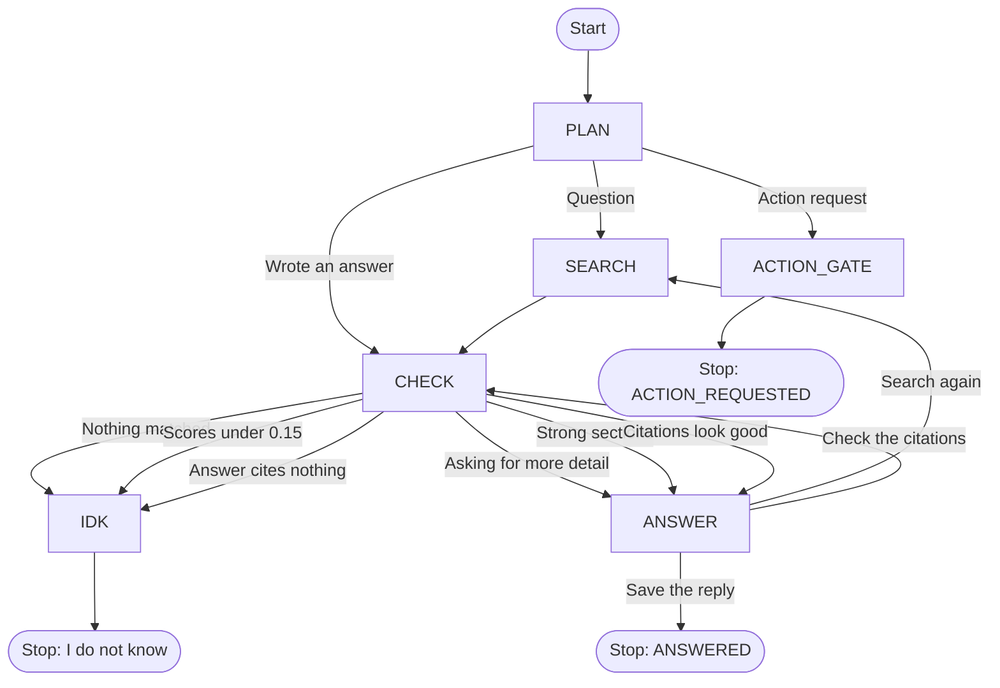

# The agent loop, drawn as boxes

This page is for someone who is new to the code. It explains `graph_agent.py`.

`agent.py` is a loop. It thinks, searches the runbooks, reads the sections, and then does that again or stops. `graph_agent.py` does the same job as a picture of boxes and arrows. Each box is one small job. The box returns the name of the next box. A short walker follows those names until a box says stop.

That kind of picture is called a state machine. You stand in one box. The box tells you where to go next. You can read one box at a time.

The page still uses `agent.py`. The graph is a second copy of the same rules so the two can be compared. It uses only the Python already in the project. LangGraph can come later.

## The picture

Follow one arrow at a time. A normal question takes the top path: PLAN, then SEARCH, then CHECK, then ANSWER. ANSWER writes the reply and sends it back to CHECK. If the reply cites a section that search really returned, CHECK sends it to ANSWER again, and that second visit saves the reply and stops.

## What each box does

- **PLAN** looks at the request, or at the sections that were just found. If this is a question, the next box is SEARCH. If this is an action request ("restart something"), the next box is ACTION_GATE. If the model writes an answer instead of calling a tool, the next box is CHECK.
- **SEARCH** calls the same `search_runbooks` tool the rest of the project uses. It only reads. It does not change a system.
- **CHECK** is the guardrails, the same rules as today.
  - Nothing came back, and nothing was read earlier: stop with `NO_RELEVANT_RUNBOOK`.
  - Sections came back, but every score is under 0.15, and nothing stronger was read earlier: stop with `WEAK_MATCH_ONLY`.
  - The next search is empty again, or weak again: stop the same way. The model was only changing the words.
  - The model wrote an answer that cites nothing: stop with `UNGROUNDED_ANSWER`.
  - A short "please tell me more" is allowed. That is a question, not a guess.
  - A strong section, or an answer that cites a real section, goes to ANSWER.
- **ANSWER** writes the reply in plain words and adds the Sources list. The list only names sections search actually returned.
- **IDK** stops. The reason is the one CHECK chose, or the step limit.
- **ACTION_GATE** shows the action and asks a person `y` or `n`. Only `y` or `yes` runs the simulation. The model cannot approve its own action. The stop reason is `ACTION_REQUESTED`.

IDK is used for four stop reasons:

- `NO_RELEVANT_RUNBOOK`
- `WEAK_MATCH_ONLY`
- `UNGROUNDED_ANSWER`
- `MAX_STEPS_REACHED`

ANSWER stops with `ANSWERED`. ACTION_GATE stops with `ACTION_REQUESTED`.

## The step limit

`MAX_STEPS` is 4, the same number as in `agent.py`. The walker counts how many times it calls the model. PLAN always calls the model, so it costs one step. ANSWER costs one step only when it still needs words. Saving a reply that CHECK already approved is free. SEARCH, CHECK, IDK, and ACTION_GATE are free.

When the count is already 4, the walker does not call the model again. It goes to IDK and stops with `MAX_STEPS_REACHED`. A model that would search forever still stops. An answer that arrives on step 4 is kept. The cap blocks the next call. It does not throw away a real answer. If no strong section was read, the words are "I could not find this in the runbooks." The stop reason name is still `MAX_STEPS_REACHED`.

## What you get back

`run_graph(request, client=None, ask=input, defer_approval=False)` takes the same arguments as `run_agent`. It returns the same kind of result: the answer text, `"denied"`, a simulated action result, or a waiting action.

The extra piece is on the trace:

- `graph_agent.last_trace.stop_reason` — why it stopped
- `graph_agent.last_trace.node_path` — the boxes it walked, as a list, such as `["PLAN", "SEARCH", "CHECK", "ANSWER", "CHECK", "ANSWER"]`
- `graph_agent.last_trace.sources`, `steps`, `thoughts`, and `events` — the same ideas as the loop

`steps` counts model calls, not boxes. A normal question uses 2 model calls and 6 boxes.

The terminal also prints one line, `Nodes visited: PLAN -> SEARCH -> CHECK -> ANSWER -> CHECK -> ANSWER`, so you can see the walk without reading the code.

## Comparing the two

The practice model (no API key) is enough. The tests run each practice question through `agent.py` and through `graph_agent.py` and check that both stop for the same reason. Named failures, such as `EMPTY_REQUEST` or `BAD_TOOL_ARGS`, are the same names too, because the graph uses the functions in `agent.py`.

If you change a guardrail, change it in both files. The comparison tests will fail if the stop reasons drift apart.
